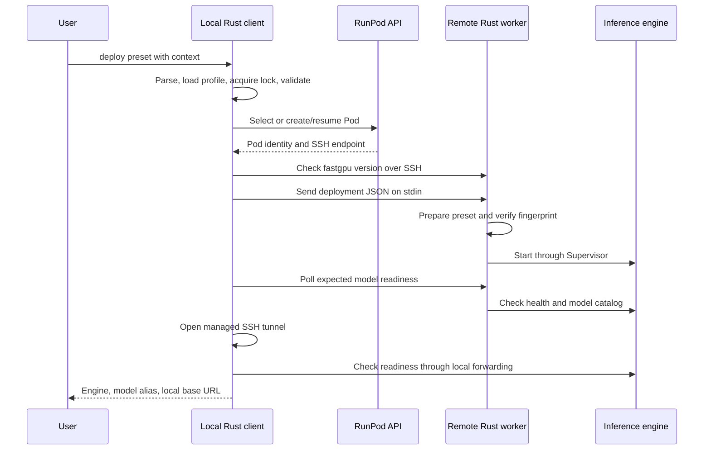

# From zero to fastgpu: Rust, SSH, RunPod, and npm

This course takes you from a first terminal command to understanding how the Rust implementation of fastgpu is assembled. It assumes no previous experience with Rust, npm, or SSH. Read Part I before Part II; work through the exercises in a separate directory. Part II walks through the actual repository, file by file, and explains the order in which to build and test each component. The repository source remains the complete implementation: examples in this course are deliberately small teaching examples, not replacements for all production checks.

This course matches the 0.3.0 source tree. The [CLI manual](manual.md) describes the available commands; the [README](../README.md) is the shorter operating introduction. The project contains infrastructure operations that can create billable resources and delete resources: use local fixtures while learning and understand a command before running it against a real account.

## Course map

| Part | What you will learn | Result |
| --- | --- | --- |
| I: Foundations | Terminal, Rust, errors, async, HTTP, SSH, storage, containers | Understand the vocabulary and the data flow |
| II: Build the project | Each source file, its functions, dependencies, and tests | Reconstruct and reason about the CLI |
| III: Distribution | Cargo releases, Node, npm tarballs, and Docker images | Build a local archive, understand compatibility, and publish a deliberate public release |
| IV: Practice | Exercises, debugging, and a final checklist | Validate your understanding without a real GPU |

## Navigation

- [Part I: foundations](#part-i--foundations)
- [SSH and port forwarding](#14-ssh-from-first-principles)
- [Part II: implement the CLI](#part-ii--build-the-cli-file-by-file)
- [A complete starter parser](#261-a-complete-starter-parser)
- [Trace a real deployment](#262-trace-a-real-deployment)
- [Part III: packaging and distribution](#part-iii--package-and-distribute)
- [Public npm releases](#31-publishing-a-public-release)
- [Part IV: practice and debugging](#part-iv--practice-and-debugging)

# Part I — Foundations

## 1. What is fastgpu?

A **command-line interface**, or CLI, is a program you operate by typing commands such as `fastgpu status`. The local `fastgpu` process asks RunPod's HTTPS API about Pods, volumes, and GPU availability. A **Pod** is the remote compute environment. A **Network Volume** is persistent storage mounted into that environment; it can remain after the Pod is terminated.

The Pod runs a container image containing software and another copy of the same fastgpu executable. Its hidden `worker` commands prepare models and manage an inference service. The local client connects with OpenSSH, copies files with rsync, and can forward a local port to the remote inference service.

```text
Local computer                               RunPod
┌───────────────────┐   HTTPS API       ┌─────────────────────┐
│ fastgpu client    │ ─────────────────> │ catalog, Pods,      │
│ config and state  │                    │ Network Volumes     │
│ private SSH key   │   SSH / rsync      │                     │
│                   │ ─────────────────> │ Pod + fastgpu worker│
│ localhost:8080    │ ─ SSH tunnel ────> │ inference :8080     │
└───────────────────┘                    │ /workspace: volume  │
                                         └─────────────────────┘
```

The provider can bill a Pod while it runs. Storage may incur charges independently, including after the Pod is stopped or terminated. The CLI's `cost` command reports a compute rate, not a final bill. `up --dry-run` asks the API for a plan without creating a Pod; it can still read resources and may update local recovery state in certain existing-state situations. Never interpret a network error as proof that a billable resource was not created.

### Vocabulary

- **Client/server:** the client initiates a request; the server receives it and responds.
- **Local/remote:** local is your computer; remote is the Pod on RunPod.
- **API:** a documented interface through which programs exchange requests and responses.
- **GPU/VRAM:** a processor suited to parallel calculations and the memory attached to it. Model size, context, and inference settings affect VRAM needs.
- **Container/image:** an image packages software; a container is a running instance of that image. The volume is separate storage mounted into it.
- **Inference:** running an existing trained model to generate outputs. Training and converting models are outside this CLI's automation.

## 2. The terminal and the operating system

A terminal displays a shell such as Bash or Zsh. The shell finds a program and passes it arguments. Practice in a disposable directory:

```sh
mkdir -p /tmp/fastgpu-learning
cd /tmp/fastgpu-learning
pwd
printf '%s\n' 'hello world'
ls -la
```

`/` is the filesystem root, `.` is the current directory, `..` is its parent, and `~` normally expands to your home. `/tmp/example` is absolute; `example` is relative to the current directory. Paths containing spaces need quoting: `cd 'my project'` passes one argument. Single quotes protect most shell metacharacters; double quotes still expand variables such as `$HOME`.

A **process** is a running program. A process inherits a working directory and environment variables from its parent. `PATH` is a list of directories searched for executable names. `export NAME=value` makes a variable available to child processes. Do not put real API keys into checked-in files or examples.

Each process has standard input (stdin), standard output (stdout), and standard error (stderr). `program > output.txt` redirects stdout; `program 2> errors.txt` redirects stderr; `first | second` connects stdout to the next process's stdin. The exit status is conventionally `0` on success and nonzero on failure; in a shell, inspect it immediately with `echo $?`.

An interactive terminal can send signals: `Ctrl-C` usually sends SIGINT to the foreground process group. A remote command can itself start further processes, so signal handling and cleanup require care.

**Exercise:** create a filename with spaces, print it with `printf '%s\n'`, and compare the arguments received with and without quotes. Do not use shell interpolation to assemble commands containing untrusted input.

## 3. Install the development tools

For the current source build you need Linux, Rust 1.91 or later with Cargo, a C compiler/linker and make. SSH and rsync are needed for remote operations. Node.js and npm are needed for the npm package; the launcher currently requires Node 22.15 or later in the 22.x series, or Node 24+. Docker is needed to build the image, not to run a prebuilt local client.

Install Rust with the [official Rust instructions](https://www.rust-lang.org/tools/install), then inspect your environment:

```sh
rustc --version
cargo --version
rustup component add rustfmt clippy
ssh -V
rsync --version
node --version
npm --version
```

Do not include credentials in a repository, command examples, logs, or a Docker build context. An environment variable avoids storing a key in source, but shell history and process environments still require care. The [CLI manual](manual.md) explains the interactive key-entry workflow.

## 4. Create and run your first Rust program

In a scratch directory:

```sh
cargo new hello-rust
cd hello-rust
cargo run
```

Cargo creates `Cargo.toml` and `src/main.rs`. Replace the source with:

```rust
fn main() {
    println!("Hello, Rust!");
}
```

Examples containing `fn main` are complete programs. Other Rust blocks are fragments: place statements inside `main` and type/function definitions at module level. Examples using external crates need the dependencies described in their chapter.

`fn` declares a function; `main` is the executable's entry point. Braces form a block, while `println!` is a macro: the exclamation mark distinguishes its invocation from a function call. `cargo run` compiles and runs; `cargo check` checks types without producing a finished executable; `cargo build --release` builds an optimized binary under `target/release/`. `cargo fmt` formats source and `cargo clippy` reports potential mistakes.

`Cargo.toml` is the package manifest. A **crate** is a compilation unit; a package may provide both a library crate (`src/lib.rs`) and a binary crate (`src/main.rs`). Dependencies are crates from the registry or other sources. `Cargo.lock` records resolved dependency versions, and `--locked` fails if the lockfile needs updating. Rust editions select language conventions; this project uses edition 2024.

**Exercise:** change the greeting, run `cargo check`, then introduce a misspelled variable. Read the compiler diagnostic and fix it before proceeding.

## 5. Variables, types, and functions

```rust
fn hourly_total(rate: f64, hours: f64) -> f64 {
    rate * hours
}

fn main() {
    let gpu_name: &str = "example";
    let mut hours: f64 = 2.0;
    hours += 1.0;
    let total = hourly_total(0.5, hours);
    println!("{gpu_name}: {total}");
}
```

`let` creates a binding; it cannot be reassigned unless marked `mut`. `: f64` is a type annotation. Rust often infers types from context, but annotations clarify APIs. `-> f64` gives a return type. The final expression has no semicolon and becomes the function's return value; adding a semicolon turns it into a statement whose value is `()` (the unit type).

`i64` and `u64` are signed and unsigned 64-bit integers. `usize` is an integer suitable for collection sizes and indexes. `f64` is floating point: decimal values can be approximate, so boundary tests matter for price comparisons. `bool` is `true` or `false`. A `char` is a Unicode scalar value, not necessarily a visible grapheme. A tuple groups values, while an array such as `[1, 2, 3]` has fixed length. `Vec<T>` is a growable sequence.

`String` owns UTF-8 text; `&str` is a borrowed string slice. Indexing a string by byte position is not generally valid for arbitrary Unicode characters. Rust's `format!` creates a `String`; `println!` prints to stdout and `eprintln!` to stderr.

**Exercise:** write a function taking a price and a maximum. Return whether the price is positive and under the maximum. Try zero, a value at the limit, and one above it.

## 6. Branches, loops, and pattern matching

```rust
fn category(price: f64) -> &'static str {
    if price < 1.5 {
        "small"
    } else if price < 3.5 {
        "medium"
    } else {
        "higher"
    }
}
```

`if` is an expression, so all branches must return compatible types. A `match` checks patterns exhaustively. `for` iterates through a collection, `while` repeats while a condition is true, and `loop` repeats until `break` or return. `0..3` excludes 3; `0..=3` includes it.

```rust
let sizes = ["small", "medium", "large"];
for size in sizes {
    match size {
        "small" => println!("lower price range"),
        other => println!("selected: {other}"),
    }
}
```

In the real `size_offers` implementation, small is below $1.50, medium is $1.50 to below $3.50, large includes $3.50 through $5, and xlarge is strictly above $5. Medium sorts by distance from $3, not simply by lowest price. Exact boundaries and ties should be tested.

## 7. Ownership, moves, and borrowing

Rust tracks who owns each value and when a resource can be freed. A `String` owns allocated text. Assigning it to another variable normally **moves** ownership:

```rust
let first = String::from("workspace");
let second = first;
println!("{second}");
// first can no longer be used here.
```

Small values implementing `Copy`, including integers and booleans, are copied instead. `clone()` explicitly creates an independent copy when the type supports it; for large values this may allocate or do expensive work.

A reference borrows without taking ownership. `&T` permits shared access; `&mut T` permits exclusive mutable access. The compiler prevents a mutable borrow from overlapping incompatible active borrows. A reference must never outlive the value it points to.

```rust
fn print_label(label: &str) {
    println!("{label}");
}

let mut label = String::from("gpu");
print_label(&label);
label.push_str("-example");
print_label(&label);
```

Lifetimes describe how long references are valid; Rust can infer many of them. `&Path` borrows a path and `PathBuf` owns one. In methods, `&self` borrows the object for reading, `&mut self` permits mutation, and `self` takes ownership. `App::up(&mut self, ...)` needs mutable access because it changes local state; a read-only selector can often use `&self`.

**Exercise:** try passing a `String` by value and then using it again. Observe the error. Change the function to borrow `&str`; explain why the caller can now reuse the string.

## 8. Structs, enums, traits, and modules

A struct gives related values names; an `impl` block supplies associated functions and methods:

```rust
#[derive(Debug, Clone)]
struct Volume {
    id: String,
    size_gb: u64,
}

impl Volume {
    fn description(&self) -> String {
        format!("{}: {} GB", self.id, self.size_gb)
    }
}
```

An enum models one of several alternatives, and variants may carry different data:

```rust
enum Action {
    Start,
    Stop,
    Select(String),
}
```

`match action { Action::Start => ..., Action::Select(id) => ..., ... }` extracts the variant's data. This is how Clap's derived `Commands` enum models subcommands.

A **trait** describes behavior a type supports. `Display` formats user-facing text; `Clone` makes an explicit copy; `Serialize` and `Deserialize` support conversion to and from serialized representations. `#[derive(...)]` generates implementations for suitable types. Generics let a function work with several types: `Vec<T>` stores elements of type `T`; `T: Serialize` means `T` must implement the trait. `impl Serialize` in an argument is a concise way to express a similar constraint.

A module organizes names. `mod api;` in `src/lib.rs` loads `src/api.rs`; `use crate::api::Api;` imports its `Api` name. `pub` exposes an item outside its module, subject to its parent's visibility. Keeping modules focused makes unsafe operations, state changes, and API calls easier to review.

## 9. Handling absence and errors

Rust encodes a possibly absent value as `Option<T>`: either `Some(value)` or `None`. It encodes a fallible operation as `Result<T, E>`: either `Ok(value)` or `Err(error)`. Both can be inspected with `match`:

```rust
fn parse_size(input: &str) -> Result<u64, std::num::ParseIntError> {
    let value = input.parse::<u64>()?;
    Ok(value)
}

match parse_size("50") {
    Ok(size) => println!("{size} GB"),
    Err(error) => eprintln!("invalid size: {error}"),
}
```

`?` returns an error early to the caller, converting it when the return type supports the conversion. `anyhow::Result` is convenient at an application boundary where several error types may occur; `.context(...)` adds an explanation without discarding the cause. A typed `ApiError` still matters because the application must distinguish status 404 from network failure.

`unwrap()` panics on `None` or `Err`; it is useful in tests but should not be the default way to handle external input. `expect("explanation")` also panics. For a missing file, matching `ErrorKind::NotFound` can be appropriate; other I/O errors must not silently turn into default data.

**Exercise:** change the example to parse `"many"`. Make the error explain what input was invalid without exposing a token or credential.

## 10. Collections, iterators, and closures

```rust
let prices = vec![0.4, 2.0, 4.0];
let affordable: Vec<f64> = prices.iter()
    .copied()
    .filter(|price| *price < 3.0)
    .collect();
assert_eq!(affordable, vec![0.4, 2.0]);
```

An iterator yields values on demand. `iter()` borrows elements; `into_iter()` may consume the collection. `filter` retains matching values, `map` transforms them, `find` returns the first match, and `collect` builds a collection. The closure `|price| ...` is an anonymous function that can capture nearby variables. Sorting with `sort_by` requires a comparison; floating-point prices use `total_cmp` in this project to provide a total ordering.

In `api.rs`, filter GPUs by secure availability, NVIDIA manufacturer, minimum VRAM, architecture, data center, and optional maximum price before applying the chosen price band. Sorting only after filtering avoids recommending a cheap but incompatible machine.

## 11. Files, paths, locks, and permissions

`std::fs::read`, `write`, and `read_to_string` interact with files. `Path` is a borrowed path and `PathBuf` is an owned path. `join` combines components; it does not itself prove that the resulting location is safe. Reject absolute paths where only relative paths are allowed and prevent `..` from escaping the chosen root. A symbolic link can point outside a lexically valid directory: the model path checks canonicalize existing paths before accepting them.

Configuration updates use a temporary file in the target directory, write and sync it, then rename it over the destination. This makes readers less likely to see a half-written JSON document. An exclusive file lock serializes cooperating processes operating on the same profile. It does not coordinate independently configured profiles or multiple computers. Unix permissions such as `0700` for private directories and `0600` for private files restrict access according to the operating system's user model.

A `Drop` implementation runs when a value leaves scope, including ordinary error returns. Here `FileLock` explicitly unlocks before its file closes. Do not assume cleanup runs after power loss or forced process termination; design on-disk state for recovery too.

## 12. Async Rust and cancellation

A network call can spend time waiting for a response. `async fn` returns a future representing work that can be polled; `.await` suspends that task until progress is possible. Tokio provides the runtime and asynchronous networking, timers, process handling, and signals.

```rust
async fn wait_a_moment() -> anyhow::Result<()> {
    tokio::time::sleep(std::time::Duration::from_secs(1)).await;
    Ok(())
}
```

`#[tokio::main]` starts the runtime. `tokio::time::timeout` bounds waiting; `tokio::select!` waits for whichever branch completes first. Dropping a future stops polling that future; it does not automatically stop independently spawned tasks, OS processes, or a request already accepted by a server. The project sets `kill_on_drop(true)` for child processes and uses guards for terminal and lock cleanup. Cancellation does not undo external actions already accepted by RunPod.

Asynchronous code is not automatically parallel and does not make blocking filesystem or CPU-heavy hashing free. Large file hashing and synchronous operations need particular attention when scaling the design. In this CLI, understand where waiting can occur before changing timeouts or cancellation behavior.

## 13. HTTP, JSON, and the RunPod API

A URL identifies a server and path. An HTTPS request has a method, headers, optional body, and response status. GET reads; POST generally creates or starts an action; PATCH updates; DELETE removes. A 2xx status denotes success; 404 indicates a missing resource; 429 indicates rate limiting; 5xx indicates a server-side failure. These are HTTP conventions; endpoint-specific semantics are determined by the provider.

A Bearer API key in an authorization header identifies the caller. HTTPS encrypts transport, but the key must still not be printed or included in uploaded Pod environment variables. JSON expresses objects, arrays, strings, numbers, booleans, and null. Serde maps Rust structures to JSON and back:

```rust
use serde::{Deserialize, Serialize};

#[derive(Debug, Serialize, Deserialize)]
#[serde(rename_all = "camelCase")]
struct ExampleVolume {
    id: String,
    data_center: String,
}
```

`data_center` maps to `dataCenter`. `#[serde(default)]` supplies defaults where the structure permits it; `skip_serializing_if` omits selected empty fields. Deserialize untrusted responses carefully and cap their size. Reqwest handles HTTPS through rustls in this project. The API client disables redirects for authenticated requests, caps ordinary responses, and redacts the key in API error details.

A list response may include a pagination cursor. Keep requesting pages until `hasNextPage` is false; reject an empty or repeated cursor to avoid an infinite loop. Retry some transient **GET** failures. A timeout on a creation POST is ambiguous: the server may have created the Pod even though the response never reached you. Save an operation identity first and reconcile it with the account's Pods before any new creation attempt.

RunPod has separate APIs for GPU catalog, Pods, and Network Volumes. Consult [RunPod documentation](https://docs.runpod.io/) for the current API and pricing; provider behavior and available GPU types can change.

## 14. SSH from first principles

SSH is a protocol and a program for encrypted remote connections. Your local client connects to an SSH server at a host and port. In public-key authentication, a private key remains local and a corresponding public key is authorized on the server. This project creates a dedicated Ed25519 key pair with `ssh-keygen` if no key exists; it sends only the public key when creating a Pod.

A server also has a **host key**, which identifies the server to the client. The client records host keys in a dedicated `known_hosts` file. `StrictHostKeyChecking accept-new` accepts an unseen key on first use and rejects unexpected changes later; the first acceptance alone does not verify the server identity.

```text
Host gpu-POD_ID
  HostName EXAMPLE_HOST
  Port EXAMPLE_PORT
  User gpu
  IdentityFile /path/to/private_key
  IdentitiesOnly yes
  StrictHostKeyChecking accept-new
```

The generated file contains the actual endpoint, key path, and dedicated known-hosts file. `ssh -F FILE ALIAS` uses this configuration. `-tt` requests a terminal. Batch mode avoids interactive password prompts; encrypted private keys should be loaded into a local agent first. Agent forwarding is disabled in the generated configuration.

A local port forward such as `ssh -L 127.0.0.1:8080:127.0.0.1:8080 ...` listens on your local loopback interface and sends connections through SSH to the Pod's loopback port. It does not expose the service to the public internet by itself. Closing the tunnel does not shut down the inference service or terminate the Pod.

Rsync transfers files over SSH. A trailing slash on a source directory affects whether its contents or the directory itself are copied. The project excludes several common secret patterns and does not pass `--delete`; this does not detect all secrets, and existing destination files can still be updated.

### What the two loopback addresses mean

Suppose your model listens at `127.0.0.1:8080` **inside the Pod**, and you choose local port 18080:

```text
Your computer                         Encrypted SSH transport             Pod
curl -> 127.0.0.1:18080 -> local ssh ===============================> sshd
                                                                        |
                                                                        v
                                                              127.0.0.1:8080
                                                               model server
```

The first `127.0.0.1` belongs to your computer. The second destination is reached from the SSH server on the Pod. Requests and replies cross the SSH connection; the HTTP client still uses an ordinary local HTTP URL. There is no need to publish inference port 8080 on RunPod. The provider exposes SSH port 22 through its assigned public TCP mapping, and that external SSH port need not be 22.

Use the actual generated endpoint/configuration rather than guessing it:

```sh
fastgpu connect --local-port 18080 --remote-port 8080
fastgpu tunnel --local-port 18080
curl http://127.0.0.1:18080/v1/models
fastgpu tunnel --close
```

The model must already be running. If `deploy` opened a tunnel on another port, close that managed tunnel before opening this one. For another service such as a notebook on remote port 8888, use the command printed by `connect --local-port 8888 --remote-port 8888`; `tunnel` itself always forwards to remote port 8080.

### How fastgpu manages the SSH process

[App::tunnel in ssh.rs](../src/ssh.rs) constructs the equivalent of this command; the paths and Pod ID below are placeholders:

```sh
ssh -F /path/to/profile/ssh_config \
  -S /path/to/profile/tunnel-POD_ID \
  -M -fN -o BatchMode=yes -o ExitOnForwardFailure=yes \
  -L 127.0.0.1:18080:127.0.0.1:8080 gpu-POD_ID
```

| Argument | Why this implementation uses it |
| --- | --- |
| `-F` | Use the generated host, public port, user, identity, and known-host settings |
| `-L` | Define the local listening address and the destination reached from the Pod |
| `-N` | Run no remote command; this SSH connection exists for forwarding |
| `-f` | Background the forwarding connection after connection setup |
| `-M` and `-S` | Create a master connection with a known control-socket path |
| `BatchMode=yes` | Fail instead of waiting for an interactive password prompt |
| `ExitOnForwardFailure=yes` | Fail when forwarding setup cannot be established |

OpenSSH documents these options in [ssh(1)](https://man.openbsd.org/ssh.1). A successful forward setup does not prove that the final model service is healthy; fastgpu performs its own HTTP/model readiness checks.

The implementation first tries `ssh -O check` against the control socket. A live tunnel with the recorded requested port can be reused. Otherwise it checks whether the local port is available, starts the master, and saves `state.tunnel_port`. `close_tunnel` sends `ssh -O exit`. This lets a later CLI process close the earlier process's managed tunnel without killing unrelated SSH sessions. The socket is local control information, not the tunnel's TCP port.

The client uses `ServerAliveInterval 20` and `ServerAliveCountMax 3`. These detect an unresponsive connection; they do not implement automatic tunnel reconnection. A local port check is also not a reservation: a process could occupy the port between that check and SSH startup, so SSH's own forwarding failure remains authoritative.

### Lifetime of each component

| Action | Local tunnel | Remote inference | Pod/volume |
| --- | --- | --- | --- |
| `deploy` succeeds | Opened/reused | Ready | Pod running; volume attached |
| Close a shell or VS Code | Separate managed tunnel may remain | Continues | Continues |
| `tunnel --close` | Closed | Continues | Continues |
| `undeploy` | Closed | Stopped | Pod remains allocated; files retained |
| `stop` | Closed | Interrupted by stopping the Pod | Pod identity retained; restart is provider-dependent |
| `down` | Closed when reachable | Terminated with Pod | Container disk lost; Network Volume retained |

Do not infer service shutdown from a disconnected HTTP client. Likewise, a running SSH master does not prove that the requested model alias is ready. These are separate conditions in the application.

### Debug the connection in order

1. `fastgpu status`: is the selected Pod running?
2. `fastgpu connect --json`: is a direct SSH mapping available?
3. `fastgpu shell true`: can SSH authenticate and execute a command?
4. `fastgpu shell curl -fsS http://127.0.0.1:8080/v1/models`: does the service respond from inside the Pod?
5. Open the managed tunnel and request the same catalog on the selected **local** port.

This isolates provider startup, authentication, remote service readiness, and local forwarding. It also explains why changing only the local API port cannot fix a model that never started.

### Quoting and command boundaries

Local `Command::args` passes separate arguments without invoking a shell. SSH remote commands, however, are interpreted remotely, so `ssh.rs` quotes each argument and wraps it carefully. A value such as `$(...)` must stay data, not become a shell command. Test spaces, empty strings, single quotes, semicolons, and dollar signs. Prefix validation also rejects traversal outside the selected lexical root; it does not turn transfer paths into a security sandbox against remote symlinks.

## 15. Containers, persistent data, and models

A Dockerfile builds an image in layers. fastgpu's multi-stage Dockerfile compiles Rust in a builder stage, then copies the executable into an NVIDIA CUDA runtime image alongside Python, model engines, SSH, and Supervisor. The final image is separate from the npm package.

When the Pod starts, `docker/entrypoint.sh` requires `/workspace` to be mounted and a public key to be supplied. It initializes `/workspace/.gpu`, establishes a persistent home, configures SSH, protects concurrent use of the same managed home with a lock, creates a readiness marker, and starts Supervisor. The configured inference service is not automatically started on first container startup.

The persistent layout includes `/workspace/.gpu/home`, `/workspace/.gpu/models`, logs, and Ollama's model store. `/home/gpu` points to the persistent home. Container disk contents outside the mounted volume can disappear when a Pod is recreated. Persist your work deliberately.

GGUF is a file format commonly used by llama.cpp. vLLM commonly uses Hugging Face checkpoints; Ollama manages its own model store and can import supported artifacts. The same model is not necessarily compatible with every engine. Context length, quantization, and model architecture affect memory requirements.

Preset downloads use a temporary `.partial` file, HTTP Range when resuming, an expected size, and SHA-256. A digest is useful only if the expected value comes from a trusted source. After verification, the file is renamed into place. Readiness checks ask whether the expected model alias is available; a running process alone is insufficient evidence that inference is ready.

# Part II — Build the CLI, file by file

## 16. Set up an isolated study project

Make a separate copy for experiments. A practical strategy is to create an empty `fastgpu-study` directory, add one module at a time, and use the real file in this repository as the detailed reference. In early steps use placeholders for modules that do not yet exist; the real files depend on each other, so copying just one source file will not necessarily compile by itself. Run `cargo check` after each coherent change. Add tests as soon as a behavior is implemented.

Suggested milestones:

1. Local parser, configuration, and tests without an API key.
2. Fake HTTP server and safe GPU selection.
3. Process and SSH behavior using fake executables.
4. Lifecycle and recovery using fake API responses.
5. Worker, model verification, and engine readiness using small fixtures.
6. Container build and npm archive; live RunPod validation only after local tests pass.

## 17. Project manifest: `Cargo.toml`, `Cargo.lock`, and ignore files

Write `[package]` with `name`, `version`, `edition`, `rust-version`, license, and repository. Under `[dependencies]`, select the features used by the implementation:

| Dependency | Role in this project |
| --- | --- |
| `clap` with `derive` | Define commands, flags, help, and argument validation |
| `serde`, `serde_json` | JSON state, API responses, manifests |
| `tokio` | Async runtime, signals, timers, processes |
| `reqwest` with rustls | HTTP client without an OpenSSL runtime dependency |
| `anyhow` | Error context and application-level propagation |
| `fs2`, `tempfile` | Locks, free-space checks, atomic replacement |
| `sha2`, `regex`, `walkdir` | Fingerprints, validation, directory traversal |
| `rand`, `toml`, `libc` | Operation names, runpodctl credentials, Unix terminal APIs |

Copy the actual feature declarations from the repository, then use Cargo to generate the lockfile. `cargo build --locked` should not rewrite it. `[profile.release]` sets optimization-related choices including stripping. `.gitignore` excludes generated artifacts and common credential files; `.dockerignore` prevents local build outputs and secrets from entering the Docker build context. An ignore rule is not a substitute for reviewing staged files.

## 18. Entrypoints: `src/lib.rs` and `src/main.rs`

In `src/lib.rs`, declare `api`, `cli`, `config`, `engines`, `info`, `lifecycle`, `models`, `process`, `ssh`, and `worker`; expose only the items needed by the binary. In `src/main.rs`, start Tokio and register Unix interrupt and termination signals. Use `tokio::select!` to wait for `fastgpu::execute()` or a signal. Print errors with the `fastgpu:` prefix and preserve a positive child exit status through `CommandFailure` when available.

Trace this path for `fastgpu --version`: the operating system starts `main`, Tokio starts the async body, `execute` asks Clap to parse arguments, and Clap's version response is printed without requiring an API key. Test help and version before adding cloud behavior.

## 19. Configuration: `src/config.rs`

Start with constants for the version, remote home, workspace, and default image. Implement `Config` as serializable fields: image, registry credential ID, selected volume, SSH key, minimum resources, disk, price limit, context, and local port. `State` tracks the selected Pod ID, pending operation name, volume ID, managed flag, and tunnel port. Neither structure should contain the RunPod API key.

Implement `Default` for configuration. `App::new` resolves `GPU_CONFIG_DIR`, otherwise `XDG_CONFIG_HOME/gpu`, otherwise the user's `~/.config/gpu`; convert the result into an absolute path. `App::load` overlays an existing configuration JSON onto the defaults, so older profiles with missing fields still load. A malformed file should return an error rather than silently overwrite the user's configuration.

Build `atomic_file` with a temporary file in the destination directory, write bytes, sync, and persist/rename; `atomic_json` serializes formatted JSON first. Make the profile directory private and use an exclusive nonblocking lock for mutations. The `FileLock` wrapper unlocks in `Drop`. `api_key` reads a nonempty `RUNPOD_API_KEY` first and otherwise parses `apikey` from the user's runpodctl TOML configuration. Never include the key in config output.

**Checkpoint:** test default values, loading old JSON, malformed JSON, file permissions, atomic output, and a second operation failing to acquire an existing lock.

## 20. API layer: `src/api.rs`

Define `Api` with a base URL, key, and reusable HTTP client. `ApiError` holds HTTP status and a redacted detail; implement `Display` and `Error`. Escape path components before inserting resource IDs into URLs. `request` sends JSON, sets authorization, bounds response data, and retries transient GET responses only. It does not blindly retry POST, PATCH, or DELETE.

Define serde data structures for volumes, mounts, endpoints, Pods, and GPUs. Provider JSON uses names such as `dataCenter` and `volumeId`; serde renaming maps them to Rust naming conventions. `list` reads all pages and records seen cursors. `pods`, `volumes`, and `pod` are narrow wrappers. `logs` reads an event stream incrementally and prints decoded `data:` records.

Implement `resolve_volume` so an exact ID takes precedence and duplicate names are rejected. Implement `eligible` and `size_offers` separately: this permits independent tests for compatibility and price-band rules. The order of sorting affects selection, especially medium's distance from $3/hour.

**Checkpoint:** use a local HTTP server to assert the request method, path, response handling, redaction, repeated cursor rejection, and one POST on a 503. No real token or account is necessary.

## 21. Processes and terminals: `src/process.rs`

Define `CommandFailure { code, program }` and implement `Display` and `std::error::Error`. Its purpose is to preserve a child process's nonzero status through `anyhow` to the top-level exit handling. `run` accepts a Tokio `Command`, optional bytes for stdin, whether to capture stdout, and whether stdin should be inherited. Configure `kill_on_drop(true)`, spawn, write input asynchronously if supplied, wait for completion, and return an error on nonzero status.

`find_program` searches executable files in `PATH`. `Terminal::save` checks whether stdin is a terminal and saves its `termios`; `Drop` restores it. The `unsafe` calls into `libc` require valid pointers and initialized values. Read the safety comments and understand that such calls bypass some of Rust's usual compile-time guarantees.

**Checkpoint:** use `sh -c 'exit 37'` as a harmless fixture; assert the exit code survives. Test cancellation and terminal restoration separately. Do not write a test that kills a real user process.

## 22. SSH and information: `src/ssh.rs`, `src/info.rs`

In `ssh.rs`, first implement path and quoting helpers. `remote_path` maps `home:` to `/home/gpu` and `vol:` to `/workspace`, rejects control characters and absolute paths, normalizes components, and checks containment. `quote` produces a shell-safe single-quoted string; `shell_words` applies it to every argument. Verify round trips through a local Bash fixture, including single quotes and command-substitution syntax.

`ssh_config` validates host, Pod ID, and port before writing a dedicated configuration. `remote` constructs the SSH argument vector and a quoted remote command; interactive requests save terminal settings. `ensure_key` checks for both private and public key files or invokes `ssh-keygen`. `tunnel` checks the local port, uses an SSH control socket, and records the port in state; `close_tunnel` asks the control master to exit. `transfer_path` extends the prefixed path rules with absolute Pod paths for transfers. `transfer` uses rsync exclusions and no deletion flag. `check_worker` compares the remote version with the client before worker-dependent operations and explains how to replace an incompatible image. `open_code` verifies the remote directory and adds an Include line to the user's SSH configuration if needed.

In `info.rs`, `public_pod_details` uses an allowlist rather than copying the entire provider response; environment and registry data may contain credentials. `connections` constructs printable SSH and tunnel examples. `info --live` additionally runs a remote Python probe.

**Checkpoint:** fake `ssh`, `rsync`, and `code` in a temporary `PATH`. Capture their argument lists and confirm paths with spaces remain one argument and output omits credential containers. Use a temporary HOME before testing modifications to SSH config.

## 23. Pod lifecycle: `src/lifecycle.rs`

`select_volume` chooses by explicit selector, saved selector, or interactive selection. A noninteractive ambiguous choice must fail rather than guess. `offers` requests the catalog for the selected volume's data center and applies API filtering. `await_ready` polls Pod status and checks the remote readiness file with a timeout.

The key invariant in `up` is **do not create a duplicate after an uncertain write**:

1. If a selected Pod exists, reuse it; if stopped, request start and wait for readiness. A different volume requires an explicit teardown first.
2. If a previous `pending_name` exists, list account Pods and reconcile by name. Refuse to guess when the result is ambiguous.
3. Before a new creation, list all account Pods and reject another active `gpu-*` Pod.
4. Select volume and offers, validate configuration, and show price information. A dry run ends before a new creation.
5. Ensure the SSH public key exists; generate and save a pending operation name and volume ID **before** sending POST.
6. Try a different offer only after an explicit capacity rejection. Preserve uncertain state on timeouts or ambiguous errors.
7. Save the returned Pod ID before waiting for startup. Check actual rate against the cap and, if needed, terminate the newly created Pod while retaining the volume.

`down` obtains the selected Pod, checks managed identity and its expected volume, closes the tunnel, requests Pod deletion, waits for termination, verifies the volume still exists, and only then clears local state. A local lock covers one profile, not concurrent creations from multiple machines or profiles.

**Checkpoint:** simulate a POST that creates a Pod but returns a 503. Restart the application with the saved state; assert reconciliation finds it and no second POST occurs. Simulate mismatched volume identity and verify `down` refuses deletion.

## 24. Presets and downloads: `src/models.rs`, `src/worker.rs`

`models.rs` defines `MODEL_ALIAS`, `MODEL_DIR`, `DEPLOY_FILE`, and `ModelPreset` values. Presets include a filename, pinned download URL, expected size, and expected SHA-256. `list_models` traverses a directory without following symlinks and prints aliases for managed preset paths or quoted absolute paths for custom files.

In `worker.rs`, define `Deployment` and `Verification` structures. `prepare_model` checks that the environment was initialized before downloading. `download_model` obtains a lock, checks free disk space, creates or opens a partial file, and resumes from its current length. A 206 response must report a matching Range; if a server replies 200, the download restarts from zero. A completed file is synced and checked for size and digest before it is renamed to its final name. A small verification metadata file supports reuse.

`supervisor` calls `supervisorctl` for the inference service. `worker_serve` loads and validates the deployment manifest, checks its fingerprint, and replaces itself with the chosen engine. `worker_check` runs diagnostic commands, including a CUDA computation.

**Checkpoint:** make a tiny local byte fixture, serve it from a test HTTP server, and test resume, server ignoring Range, wrong Range, bad digest, and reuse. Never use a fake digest to claim that a real model is verified.

## 25. Engines and readiness: `src/engines.rs`

Start with `default_model_name`, `model_path`, and `validate_deployment`. Validate the engine name, model alias, context range, Hugging Face ID, tokenizer, Modelfile, and extra arguments. Reserved options protect CLI-managed addresses, ports, model names, and other settings. Then implement `persistent_path`, resolving symlinks and requiring the resolved path to stay on the Network Volume.

`gguf_fingerprint` checks the GGUF magic, file size, and SHA-256, with a cache tied to file metadata. `deployment_fingerprint` handles GGUF files, checkpoint metadata, Hugging Face IDs, and Modelfiles as implemented in the source. The cache assumes trusted processes on the volume; it is not a defense against a malicious process deliberately preserving metadata.

`engine_command` returns a program name and an argument vector for llama.cpp, Ollama, or vLLM. For managed services the host is loopback and the port is 8080. `ready_model` checks health and the expected catalog alias; Ollama additionally checks its loaded models. `worker_deploy` serializes changes with a lock, resolves presets and fingerprints, reuses an identical ready deployment, otherwise stops the prior service, writes the manifest, starts the service, and handles Ollama import/load. `worker_ready` checks the current manifest.

**Checkpoint:** use a local fake HTTP server to return the wrong alias, then the right alias. A healthy HTTP server returning a different model must not count as ready. Real GPU generation remains a separate validation task.

## 26. Command parser and dispatch: `src/cli.rs`

Define `Cli` with Clap's `Parser` derive and an optional `Commands` enum. Each enum variant describes a command and its argument fields. Use nested enums for `ModelCommand`, `VolumeCommand`, and hidden `WorkerCommand`. `Up` groups mutually exclusive size flags; `Deploy` captures model, engine, context, tokenizer, and repeatable `--arg` values. `shell` uses trailing arguments so options after the remote program are passed through to that program.

`execute` handles help/version before loading configuration. With no subcommand, it prints root help and returns successfully; it never defaults to `up`. The root command uses `HELP_BANNER` as Clap `before_help`, preserving the supplied ASCII logo. With a command, execution constructs `App` and delegates to `App::dispatch`. `dispatch` acquires the profile lock for the operations identified as mutations and routes to the relevant module. Volume deletion requires the exact ID confirmation and checks configured, managed, and attached volumes. The `deploy` method validates first, starts or reuses a Pod, checks the remote CLI version, sends a JSON manifest over SSH stdin, waits for readiness, opens the tunnel, and checks the model through that tunnel.

**Checkpoint:** enumerate help pages, test mutual exclusion and invalid arguments, and verify `shell` does not consume flags intended for the remote command. Test `volume` as an alias for `volumes`. Read the [command manual](manual.md) alongside the enum definitions.

### 26.1 A complete starter parser

Build this small teaching program in a separate directory. It demonstrates typed arguments, dispatch, filesystem errors, and help without making any cloud requests. The command is named `fastgpu-study`; `inspect` is a teaching command, not a production fastgpu subcommand.

```sh
cargo new fastgpu-study --edition 2024
cd fastgpu-study
cargo add clap@4.5 --features derive
cargo add anyhow@1
```

Replace `src/main.rs` with this complete program:

```rust
use anyhow::{Context, Result};
use clap::{CommandFactory, Parser, Subcommand};
use std::path::PathBuf;

#[derive(Parser)]
#[command(name = "fastgpu-study", about = "Local CLI exercise", version)]
struct Cli {
    #[command(subcommand)]
    command: Option<Action>,
}

#[derive(Subcommand)]
enum Action {
    /// Inspect a local file without changing it
    Inspect { path: PathBuf },
}

fn main() -> Result<()> {
    let cli = Cli::parse();
    match cli.command {
        None => {
            Cli::command().print_help()?;
            println!();
        }
        Some(Action::Inspect { path }) => {
            let metadata = std::fs::metadata(&path)
                .with_context(|| format!("cannot inspect {}", path.display()))?;
            println!("{}: {} bytes", path.display(), metadata.len());
        }
    }
    Ok(())
}
```

Run these local checks:

```sh
cargo run --
cargo run -- inspect Cargo.toml
cargo run -- inspect /path/that/does/not/exist
cargo run -- inspect --help
```

The missing-path command should fail with context. The no-argument command should print help and succeed. `PathBuf` owns the supplied path; `metadata(&path)` borrows it, so the same path remains available for the error and success messages. `?` converts the I/O failure into the application's `anyhow::Error`.

The production CLI adds asynchronous dispatch, signal handling, the `fastgpu:` error prefix, profile locks, and typed child exit statuses. Move behavior into modules when adding those concerns. For parser customization beyond this example, consult [Clap's derive tutorial](https://docs.rs/clap/latest/clap/_derive/_tutorial/index.html).

### 26.2 Trace a real deployment

Follow `fastgpu deploy qwen3.8-27b --context 16384` through the source:



1. `main.rs` runs `execute` alongside signal listeners. An interrupt cancels the selected local future; it cannot reverse an accepted provider request.
2. `Cli::try_parse` builds `Deploy`. `App::dispatch` acquires the profile lock before the deployment flow changes state.
3. `App::deploy` applies invocation overrides, resolves target syntax, derives the served name, and calls `validate_deployment`.
4. `App::up` reuses or creates the Pod and persists its identity. It skips default preparation here because the worker will prepare the actual requested target.
5. `check_worker` requires the matching version. A local upgrade alone cannot replace `/usr/local/bin/fastgpu` in an existing image.
6. `serde_json::to_vec` encodes the manifest; `remote` sends it to `fastgpu worker deploy` through stdin. The manifest is not pasted into a shell command or mixed with API credentials.
7. `worker_deploy` locks remote deployment state, resolves the preset, checks integrity and persistent paths, and computes the desired fingerprint. An identical ready manifest returns early. Otherwise it stops the prior service, saves the desired manifest, and asks Supervisor to start `inference`.
8. Supervisor starts `worker serve`; that worker validates the saved manifest/fingerprint and uses Unix `exec` to replace itself with `llama-server`, `ollama`, or `vllm`. Supervisor therefore tracks the actual engine process.
9. The client polls `worker ready`, opens the SSH tunnel, and makes a final model check through the local endpoint.

Readiness, identity, and integrity solve different problems. A checksum checks the expected file content; a manifest fingerprint detects a changed deployment; a catalog check ensures that the advertised alias is the one requested. A real generation then tests a behavior that none of these checks alone proves.

### 26.3 Why the implementation uses several locks

| Lock | Scope | Protected operation |
| --- | --- | --- |
| `PROFILE/lock` | Cooperating local CLI processes for one profile | Local state/configuration mutations |
| `/workspace/.gpu/workspace.lock` | Cooperating container startups on one volume | Exclusive use of the managed persistent home |
| `/workspace/.gpu/models/download.lock` | Managed model downloads in that directory | Partial-file writes and final verification |
| `/workspace/.gpu/lock` | Remote deployment requests | Manifest replacement and service switching |

A lock is held by an open file handle/guard, not by the mere existence of its filename. `Drop` normally releases the guard on error or return. Deleting a lock filename while a process still owns the old file can defeat the intended coordination. Different profiles on different computers still need provider-side reconciliation; these file locks are not a global distributed transaction.

### 26.4 State transitions and failure boundaries

Think of creation as an operation with durable checkpoints:

```text
No selected Pod
    -> save pending_name and volume_id
    -> send creation POST
    -> save returned pod_id
    -> wait for container/SSH readiness
    -> optionally prepare model
```

The uncertain interval is between the POST and reliable persistence of its result. On the next invocation, the pending name supports reconciliation. A known capacity rejection is different from a lost response: the former can permit another compatible offer; the latter must preserve uncertainty.

Termination has its own boundary: provider deletion can succeed before the subsequent volume check fails. Report that distinction rather than claiming that nothing changed. In the current source, an already-absent Pod (404) clears local state directly; a normal successful termination also verifies the volume first.

When extending the CLI, put argument validation before expensive mutations where possible, save identities before waiting, and write tests around externally observable outcomes: number of API writes, exact deletion target, retained state, and propagated error status.

## 27. Container files: `docker/`

Read `docker/Dockerfile` from top to bottom. The `cli` stage copies the Cargo manifest and Rust source and builds the release executable. The final CUDA stage installs Ubuntu packages and Python requirements, executes the numbered scripts in `docker/install.d/`, installs the CLI, creates the `gpu` user, copies configuration, and selects the entrypoint.

`docker/packages.apt` lists system packages; `docker/requirements.txt` lists Python requirements. The numbered installation scripts install build dependencies and tools such as GitHub CLI, Codex, llama.cpp, and Ollama. `entrypoint.sh` prepares the persistent workspace and SSH. `supervisord.conf` defines the SSH server and the disabled-by-default inference program with persistent logs. Inspect each file before changing it; external binaries and dependencies should be pinned and verified according to the repository's existing approach.

`make image` builds the complete image, which can be large. `docker build --target cli -f docker/Dockerfile -t fastgpu-cli-test .` checks just the builder stage. Neither build publishes an image. The 0.3.0 Rust worker must be present in an image used for deployment; changing the local executable alone does not replace a Pod's image.

## 28. Tests: `src/tests.rs` and `tests/cli.rs`

Unit tests can access internal modules through `#[cfg(test)]`; integration tests run the compiled executable as an external user would. The Rust tests use temporary directories, fake API servers, and fake programs rather than relying on real credentials or cloud resources. Examples include pagination loops, transient reads, uncertain creation, protected volumes, fingerprint changes, readiness aliases, SSH quoting, and process exit codes.

```sh
cargo fmt --all -- --check
cargo test --locked
cargo clippy --locked --all-targets -- -D warnings
# Or run all three:
make test
```

A good test checks an observable contract: for example, one POST after an ambiguous failure, or no DELETE for a protected volume. A test that merely repeats an implementation's internal steps can pass while the user-facing behavior remains wrong. Local mocks do not validate real API compatibility, GPU availability, inference, or billing.

# Part III — Package and distribute

## 29. Node.js and npm basics

Node.js runs JavaScript outside the browser. npm distributes packages and creates executable command links from a package's `bin` mapping. A package can contain native programs as well as JavaScript. Here npm is the delivery mechanism; Rust still implements the CLI.

There are three distinct artifacts:

| Artifact | Where it runs | What it contains |
| --- | --- | --- |
| Native `fastgpu` executable | Local Linux machine or container | Compiled client and internal worker code |
| npm `.tgz` | Installed on the user's local machine | Native executable, Node launcher, metadata, logo, license, docs |
| CUDA container image | RunPod | Worker executable, SSH, Supervisor, inference engines, runtime libraries |

Publishing one artifact does not publish the other two or update a running Pod. The npm package does not contain model weights, CUDA engines, SSH private keys, or RunPod credentials. Node is required to launch the npm-installed command; the separately installed native executable does not need Node or Cargo at runtime.

The current repository's `package.json` sets `private: true`. It supports local packing/installation and deliberately prevents registry publication. Its platform metadata restricts the archive to Linux x64 with glibc. Do not present `npm install -g fastgpu` from an unspecified public registry as the current installation procedure: the supported distribution here is the local archive until a maintainer deliberately publishes an owned package name.

## 30. npm files and lifecycle

### Package layout

```text
package.json
npm/
  fastgpu.cjs             Node launcher exposed as the fastgpu command
  bin/fastgpu             Compiled Linux x64 executable copied by prepack
scripts/
  build-npm.cjs           Build/validation hook used from the source checkout
logo/fastgpu-logo.svg     Image referenced by README.md
README.md
LICENSE
DESIGN.md
docs/
```

The `bin` mapping connects the public command name to the launcher:

```json
{
  "bin": {
    "fastgpu": "npm/fastgpu.cjs"
  }
}
```

This is a fragment of the manifest, not its replacement. The package name can later be scoped while the installed command remains `fastgpu`. The actual `files` allowlist includes the launcher, executable, logo, `docs/`, and `DESIGN.md`; npm also includes standard metadata/readme/license files. It does not include the entire repository. Read [npm's manifest reference](https://docs.npmjs.com/cli/v11/configuring-npm/package-json/) when changing `bin`, `files`, platform fields, or publication settings.

### The prepack hook, step by step

`make npm-package` invokes `npm pack --pack-destination dist`. npm's `prepack` lifecycle hook runs `node scripts/build-npm.cjs` before assembling the archive. The source hook:

1. Requires Linux x64 on the packaging machine.
2. Runs `cargo metadata --no-deps --format-version 1 --locked` and finds the Rust package named `fastgpu`.
3. Requires Cargo's version and `package.json`'s version to agree.
4. Builds with `make build`, or accepts `FASTGPU_NPM_BINARY` when a prebuilt executable is supplied.
5. Checks the ELF magic, 64-bit/little-endian format, and x86-64 machine identifier.
6. Runs the binary's `--version` and compares the exact version string.
7. Copies it to `npm/bin/fastgpu` and sets executable permissions for both binary and launcher.

`FASTGPU_NPM_BINARY` skips the compilation step, not Cargo metadata or validation. Cargo is therefore still required on this project's packaging machine. It is not required on the consumer's machine when installing the resulting archive.

`prepack` runs while preparing the package, not as an installation hook for the consumer. This project defines no `preinstall`, `install`, `postinstall`, or `prepare` scripts that fetch or compile a native program during ordinary archive installation. `npm pack --dry-run` can still invoke lifecycle hooks; it is not necessarily a no-build operation. See [npm's lifecycle documentation](https://docs.npmjs.com/cli/v11/using-npm/scripts/).

### The launcher is a process replacement

Read [npm/fastgpu.cjs](../npm/fastgpu.cjs). Its central call is:

```javascript
process.execve(binary, [binary, ...process.argv.slice(2)], process.env);
```

`binary` is the packaged executable path. The new argv starts with that executable and then the user's arguments; the supplied environment is inherited. On success, `execve` replaces the Node process and does not return. This avoids keeping a JavaScript parent responsible for forwarding signals or managing a second terminal-owning process. The launcher checks the platform, API availability, and executable permission before replacement.

The repository accepts Node 22.15+ in the 22.x series or Node 24+. `process.execve` was added in Node 22.15/23.11 and is documented as experimental; runtime behavior on failures has changed across Node releases. Treat the package's supported versions and executable tests as the compatibility contract, and consult [Node's API reference](https://nodejs.org/api/process.html#processexecvefile-args-env) before changing it.

### Build and test a local archive

From the source checkout:

```sh
make test
make test-npm
make npm-package
```

The current unscoped archive is `dist/fastgpu-0.3.0.tgz`. Test it in a temporary prefix without replacing a global installation:

```sh
package_test_dir=$(mktemp -d)
npm install --global --prefix "$package_test_dir" --offline --ignore-scripts \
  ./dist/fastgpu-0.3.0.tgz
GPU_CONFIG_DIR="$package_test_dir/profile" "$package_test_dir/bin/fastgpu" --version
GPU_CONFIG_DIR="$package_test_dir/profile" "$package_test_dir/bin/fastgpu" --help
```

Inspect the resulting `package_test_dir` and remove that temporary directory when done. `tests/npm.test.cjs` validates argument/environment/stream handling, process identity, signals, exit status, and launcher errors. `tests/npm-package.test.cjs` verifies archive files and permissions and performs an offline temporary installation. It currently also asserts `private: true`; a deliberate public release must update that expectation to match the new release policy.

### Native compatibility is part of the package

An ELF header check does not prove that a binary runs on every Linux distribution. Its imported system-library symbols depend on the build environment. Building on a new glibc system can produce a binary that fails to load on an older one; npm metadata cannot fix that at runtime.

Use an appropriate build baseline and test the actual executable/archive on target systems. The project's [Docker CLI-stage workflow](manual.md#portable-build-baseline) uses Debian Bookworm and accepts the result through `FASTGPU_NPM_BINARY`. An Alpine/musl package, ARM64 build, macOS client, or Windows port would require separate work and validation. The current code uses Unix-specific APIs and the package explicitly targets Linux x64/glibc.

For broader native distribution, one possible future design is a small platform-selecting package plus separate platform-specific packages. That is an architectural option, not something the current launcher implements. Keep one tested platform working before adding a build matrix.

## 31. Publishing a public release

This section is a maintainer workflow. It explains the changes and commands required for publication; npm publication remains disabled until you deliberately apply them. Publishing source, publishing an npm binary archive, and publishing the worker image are separate operations.

### Step 1: choose an owned name and prepare source

Use a package name you control. A scope such as `@your-scope/fastgpu` distinguishes ownership while keeping `bin.fastgpu` as the shell command. Replace `your-scope` with your actual lowercase npm username or organization; do not assume that the unscoped `fastgpu` name is available.

Prepare a reviewed source commit and corresponding release notes. The project declares GPL-3.0-only in its manifests; include [LICENSE](../LICENSE) and arrange access to the matching source and build instructions when distributing its binary. A link to a moving branch is not an exact record of what produced a release. Versioned source, `Cargo.lock`, build inputs, and an image digest make the release reproducible and inspectable.

### Step 2: opt into public npm publication

In a release checkout, these commands express the intended manifest changes:

```sh
npm pkg set 'name=@your-scope/fastgpu'
npm pkg delete private
npm pkg set 'publishConfig.access=public'
npm pkg set 'publishConfig.registry=https://registry.npmjs.org/'
```

Retain `bin`, `files`, `os`, `cpu`, `libc`, `engines`, license, and scripts unless you have a tested reason to change them. A scope does not require renaming the Rust crate: `build-npm.cjs` intentionally locates Cargo's `fastgpu` package. `private: true` blocks publishing even when `--access public` is supplied; removing that guard is a deliberate release change. See [npm's `private` and `publishConfig` fields](https://docs.npmjs.com/cli/v11/configuring-npm/package-json/#private).

Review the current `docs/` allowlist too. It includes all files underneath that directory, including working notes if present. For a public release, choose the intended public documentation explicitly and update the archive-file expectations accordingly. Git ignore rules alone are not a substitute for inspecting the resulting tarball.

### Step 3: synchronize release versions

For a new patch release, for example `0.3.1`, update the npm version without an automatic Git commit/tag:

```sh
npm version 0.3.1 --no-git-tag-version
```

This changes npm metadata only. In this repository also update and review:

| Location | Release-sensitive value |
| --- | --- |
| `Cargo.toml` | Rust package version; generates `CARGO_PKG_VERSION` |
| `Cargo.lock` | Root package metadata consistent with the manifest |
| `package.json` | Matching npm version and publication policy |
| `src/config.rs` | Default matching worker-image tag when releasing a new version |
| `Makefile`, `docker/Dockerfile` | Default image tag and image version label |
| `tests/cli.rs`, `src/tests.rs` | Literal version expectations and SSH version fixtures |
| `tests/npm-package.test.cjs` | Private/public policy and intended archive-file expectations |
| Documentation | Download filenames, image references, examples, and validation record |

Regenerate/update the Cargo lockfile as needed for the changed root package and review its diff; do not accidentally fold unrelated dependency upgrades into the release. Then run the locked checks. The packaging hook refuses a mismatch between Cargo, npm, and the binary. The remote worker also checks the client version during deployment. See [npm version](https://docs.npmjs.com/cli/v11/commands/npm-version/) for its Git-tag and script behavior.

Build and publish the matching worker image through the [image workflow](manual.md#upgrading-the-image), record its digest, and make it available to consumers. npm publication alone cannot make a private local Docker image usable by RunPod.

### Step 4: build the exact archive you will publish

After completing the preceding release changes:

```sh
make test
make test-npm
make npm-package
```

`make npm-package` prints the archive filename. For the scoped name and example version above it will normally be `your-scope-fastgpu-0.3.1.tgz`; use the actual output. Inspect the real archive, not just your working directory:

```sh
release_archive='./dist/your-scope-fastgpu-0.3.1.tgz'
tar -tzf "$release_archive"
tar -xOf "$release_archive" package/package.json
sha256sum "$release_archive"
```

Check the native executable, executable permissions, launcher, logo/README paths, intended docs, license, and platform metadata. Exclude credentials, account state, private keys, local logs, and unrelated notes. Install this exact archive into a temporary prefix as in the previous chapter and test it on supported Linux baselines. `npm pack --dry-run` is useful for previewing contents, but a real archive is what you will distribute. See [npm pack](https://docs.npmjs.com/cli/v11/commands/npm-pack/).

### Step 5: authenticate and publish deliberately

Create/choose your npm account and enable the authentication required for publication. For an interactive release:

```sh
npm login --registry=https://registry.npmjs.org/
npm whoami --registry=https://registry.npmjs.org/
```

Follow the browser/authentication prompts. Do not place tokens in the repository or in example command lines. See [npm login](https://docs.npmjs.com/cli/v11/commands/npm-login/).

Preview publication of the reviewed archive, then run the actual publication command when ready:

```sh
npm publish "$release_archive" --access public --dry-run
# This next command publishes to the public registry:
npm publish "$release_archive" --access public
```

A scoped package needs public access explicitly. Current npm documentation requires 2FA for direct publishing or an eligible granular token with bypass-2FA; the interactive path should use the prompted authentication. A dry run does not prove that the account has permission to publish. See [npm's scoped public-package workflow](https://docs.npmjs.com/creating-and-publishing-scoped-public-packages/).

Publishing the reviewed `.tgz` avoids unintentionally rebuilding different bytes from a changed working tree. A published name/version pair cannot be overwritten or reused after unpublishing. If a release is wrong, prepare a new version. See [npm publish](https://docs.npmjs.com/cli/v11/commands/npm-publish/).

### Step 6: verify the consumer workflow

After publication, query the exact package/version and test a fresh installation:

```sh
npm view @your-scope/fastgpu@0.3.1 version dist.integrity os cpu libc engines
npm install -g @your-scope/fastgpu@0.3.1
fastgpu --version
fastgpu --help
```

Users then configure their own RunPod credentials and volume; none come from the package. Test the matching image and a real model before claiming GPU inference support for that release. The release notes should identify supported platforms and distinguish local checks from cloud tests.

For a preview release, use a new prerelease version and a non-default distribution tag deliberately. Do not replace a stable release's bytes to repair it. A later install/update is still a user action; publishing a new version does not replace already running clients or Pods.

### Step 7: automate later with trusted publishing

Once package ownership/settings are established, npm trusted publishing can authenticate a supported CI workflow through OIDC rather than a long-lived write token. Configure the exact repository, workflow filename, and any environment in the package settings. For GitHub Actions, use supported GitHub-hosted runners and grant the job `contents: read` and `id-token: write`.

The documented minimums are npm 11.5.1 and Node 22.14; use a supported Node/npm combination that also meets this launcher's stricter runtime requirement, such as a compatible Node 24+ setup. Build, test, inspect, and publish the same archive in the authorized workflow. As currently documented, a new trusted-publisher configuration must complete a successful publication within two days, and GitHub/GitLab trusted publishing generates provenance automatically. These service rules can change; verify [npm trusted publishing](https://docs.npmjs.com/trusted-publishers/) when implementing the workflow.

Trusted publishing controls who may upload a package. It does not validate Rust behavior, native compatibility, archive contents, or GPU inference. Those remain release checks maintained in this project.


# Part IV — Practice and debugging

## 32. Exercises in increasing difficulty

1. **Rust syntax:** implement `fn is_affordable(price: f64, cap: f64) -> bool`. Test zero, positive price, exact cap, and above cap. Explain how you treat a disabled cap.
2. **Ownership:** write a function accepting `&str` and returning a normalized `String`. Show that the caller can continue using the original input.
3. **Errors:** parse an integer from text into `Result`. Add context to an invalid value; avoid `unwrap` on user input.
4. **Selection:** create three in-memory GPU structs. Filter by VRAM and data center, then sort by price. Add tests around price-band boundaries.
5. **State:** write a small JSON object to a temporary directory and load it. Test missing and malformed files separately.
6. **HTTP:** write a local fake server that returns two pages. Add a test for a repeated cursor and assert that the client stops with an error.
7. **Shell quoting:** round-trip arguments containing spaces, quotes, and `$()` through a local test shell. Assert that no extra command executes.
8. **Recovery:** simulate a lost creation response and verify that a retry reconciles the operation name without creating another Pod.
9. **Models:** serve a small byte sequence locally, resume it with Range, and compare a SHA-256 digest before renaming the partial file.
10. **npm:** build a local tarball and install it into a temporary prefix. Check `--version`, `--help`, exit codes, and signals without changing the global installation.

## 33. Common diagnostics

| Symptom | What to inspect |
| --- | --- |
| `borrow of moved value` | Was an owned `String` or collection passed by value? Borrow it if ownership need not transfer. |
| `cannot borrow as mutable` | Does the operation actually modify the value? Declare the binding mutable and avoid overlapping borrows. |
| `?` cannot convert an error | Check the enclosing function's return type and required conversion; add context where useful. |
| `future cannot be sent` | Check values held across `.await` and the runtime requirements; avoid retaining unsuitable guards across suspension. |
| `fastgpu` command not found | Inspect `PATH`, `command -v fastgpu`, the installation prefix, and whether the shell has refreshed its environment. |
| API key missing | Check the environment or runpodctl configuration without printing the secret into logs. |
| SSH host key changed | Verify the remote server identity before changing the dedicated known-hosts file. |
| Creation outcome uncertain | Inspect `fastgpu recover` and account Pods; reconcile before clearing state or trying another creation. |
| Model not ready | Inspect `fastgpu logs`, engine compatibility, model paths, VRAM, and the requested alias; the Pod can remain running. |
| npm archive fails on another Linux | Inspect architecture, Node version, executable permission, and glibc compatibility. |

## 34. Final review checklist

- Explain what is local, what runs on the Pod, and what persists on the Network Volume.
- Explain why ownership, borrowing, `Option`, `Result`, and `Drop` matter for files and subprocesses.
- Trace a command from Clap parsing through `App::dispatch` to its module and tests; explain why no arguments print help without opening a cloud environment.
- Explain why an interrupted POST cannot safely be retried as if it were a GET.
- Identify the controls preventing deletion of the configured, managed, or attached volume.
- Describe how SSH keys, host keys, command quoting, rsync, and local port forwarding differ.
- Describe the difference between model integrity, model readiness, and a successful real inference.
- Explain what goes into the npm archive, why it needs Node at runtime, why the worker image is separate, and which deliberate changes permit a public npm release.
- Run local tests before any live experiment; check the actual provider state and storage after testing.

## Further reading

- [The Rust Programming Language](https://doc.rust-lang.org/book/) and [Rust by Example](https://doc.rust-lang.org/rust-by-example/)
- [The Cargo Book](https://doc.rust-lang.org/cargo/), [Tokio tutorial](https://tokio.rs/tokio/tutorial), and [Serde documentation](https://serde.rs/)
- [OpenSSH manuals](https://www.openssh.com/manual.html) and [rsync documentation](https://download.samba.org/pub/rsync/rsync.1)
- [RunPod documentation](https://docs.runpod.io/), [Docker documentation](https://docs.docker.com/), and [npm documentation](https://docs.npmjs.com/)
